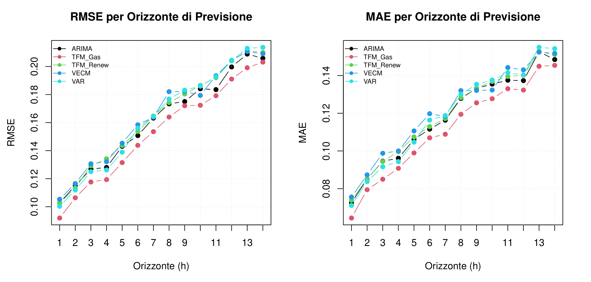

# Tra Vecchie e Nuove Fonti: Modellazione Econometrica del Mercato Energetico Italiano
# *Econometric Modelling of the Italian Energy Market*

**[Italiano](#italiano) · [English](#english)** · [Report (PDF)](report.pdf) · [Web](https://gabripaganelli.github.io/projects/energy-market.html)


*Errore di previsione fuori campione (RMSE e MAE) per orizzonte da 1 a 14 giorni: il modello a funzione di trasferimento con il gas (TFM_Gas) è il più accurato · Out-of-sample forecast error (RMSE and MAE) by horizon, 1–14 days: the gas transfer-function model (TFM_Gas) is the most accurate — report, §7.4*

---

## Italiano

### Panoramica

Progetto universitario di analisi delle relazioni dinamiche tra il PUN (Prezzo Unico Nazionale),
il prezzo del gas naturale e la produzione da fonti rinnovabili nel mercato elettrico italiano
nel periodo 2021–2025, nell'ambito del corso di Modelli Statistici per Dati Economici (gennaio 2026).

### Metodologia

L'analisi impiega una suite di modelli di serie storiche:

- **SARIMA** — modellazione univariata del PUN con componente stagionale
- **Transfer Function** — effetto del prezzo del gas sulle variazioni del PUN
- **VECM** (Vector Error Correction Model) — relazioni di cointegrazione di lungo periodo
- **VAR** (Vector Autoregression) — dinamiche di breve periodo tra le tre serie

I dati coprono il periodo 2021–2025 a frequenza giornaliera (con stagionalità settimanale).

### Struttura del repository

```
italian-energy-market/
├── README.md
├── LICENSE
├── CITATION.cff
├── .gitattributes
├── report.pdf                 # Report pre-compilato
├── figures/                   # Immagine del README
├── energy_analysis.Rproj      # RStudio project
├── analysis/
│   └── report.Rmd             # Documento principale
├── data/
│   ├── prezzi/                # Prezzi orari PUN (GME, Anno_YYYY_12.xlsx)
│   ├── gas/                   # Prezzi gas MGP (GME, Annotermico_*.xlsx)
│   └── rinnovabili/           # Produzione rinnovabile (Terna, Rinnovabili_YYYY.xlsx)
└── output/                    # PDF rigenerato (non tracciato da git)
```

### Installazione

R ≥ 4.0 e RStudio. Aprire `energy_analysis.Rproj` in RStudio per attivare la
gestione automatica dei path.

```r
install.packages(c("here", "forecast", "dplyr", "readxl", "lubridate",
                   "tidyverse", "vars", "dynlm", "urca", "lmtest",
                   "MTS", "knitr", "kableExtra"))
```

### Utilizzo

```r
# Per compilare il report PDF
rmarkdown::render("analysis/report.Rmd", output_dir = "output")
```

### Risultati

**Risultati principali** (dalle conclusioni del report):
- Prezzo del gas e PUN sono cointegrati, con un'elasticità di lungo periodo di circa 0,84; il gas è debolmente esogeno, mentre il PUN si riaggiusta verso l'equilibrio del 13% per periodo
- Nel modello a funzione di trasferimento Gas → PUN il gas ha un effetto immediato (0,54%) seguito da un effetto ritardato (0,24%)
- Nel confronto fuori campione (rolling forecast a 14 giorni) il modello TFM_Gas ha RMSE e MAE più bassi a ogni orizzonte; il test di Diebold-Mariano contro ARIMA è significativo su tutti i 14 orizzonti (p ≤ 0,0275)

Il report pre-compilato è disponibile in [`report.pdf`](report.pdf) per la visualizzazione diretta.
Nuove compilazioni vengono salvate in `output/report.pdf` (cartella non tracciata da git).

Il report include:
- Analisi di stazionarietà e test di cointegrazione
- Stime e diagnostiche dei modelli SARIMA, Transfer Function, VECM e VAR
- Funzioni di risposta all'impulso (IRF) e decomposizione della varianza
- Interpretazione economica delle relazioni tra le tre serie

### Autori

**Giorgia Caicchiolo, Gabriele Paganelli** — Modelli Statistici per Dati Economici, Università di Padova, gennaio 2026.

### Fonti dei dati

- **PUN**: [GME — Dati Storici MGP](https://www.mercatoelettrico.org/it-it/Home/Esiti/Elettricita/MGP/Statistiche/DatiStorici)
- **Gas**: [GME — Dati Storici MGS](https://www.mercatoelettrico.org/en-us/Home/Results/Gas/MGS/StatisticalData/HistoricalData)
- **Rinnovabili**: [Terna — Download Center](https://dati.terna.it/en/download-center#/load/total-load)

Il MIT copre solo il codice: i dati in `data/` provengono da GME e Terna e restano soggetti alle loro condizioni d'uso.

---

## English

### Overview

University project analysing the dynamic relationships between the PUN (Italian
National Electricity Price), natural gas prices, and renewable energy production
in the Italian electricity market over the period 2021–2025. Developed for the
Statistical Models for Economic Data course (January 2026).

### Methodology

The analysis employs a suite of time-series models:

- **SARIMA** — univariate modelling of the PUN with seasonal component
- **Transfer Function** — effect of gas prices on PUN fluctuations
- **VECM** (Vector Error Correction Model) — long-run cointegration relationships
- **VAR** (Vector Autoregression) — short-run dynamics among the three series

Data cover the period 2021–2025 at daily frequency (with weekly seasonality).

### Repository Structure

```
italian-energy-market/
├── README.md
├── LICENSE
├── CITATION.cff
├── .gitattributes
├── report.pdf                 # Pre-compiled report
├── figures/                   # README image
├── energy_analysis.Rproj      # RStudio project
├── analysis/
│   └── report.Rmd             # Main document
├── data/
│   ├── prezzi/                # Hourly PUN prices (GME, Anno_YYYY_12.xlsx)
│   ├── gas/                   # Gas spot prices (GME, Annotermico_*.xlsx)
│   └── rinnovabili/           # Renewable production (Terna, Rinnovabili_YYYY.xlsx)
└── output/                    # Regenerated PDF (not tracked by Git)
```

### Installation

R ≥ 4.0 and RStudio. Open `energy_analysis.Rproj` in RStudio to enable
automatic path management.

```r
install.packages(c("here", "forecast", "dplyr", "readxl", "lubridate",
                   "tidyverse", "vars", "dynlm", "urca", "lmtest",
                   "MTS", "knitr", "kableExtra"))
```

### Usage

```r
# Compile the PDF report
rmarkdown::render("analysis/report.Rmd", output_dir = "output")
```

### Results

**Key findings** (from the report's conclusions):
- Gas prices and the PUN are cointegrated, with a long-run elasticity of about 0.84; gas is weakly exogenous, while the PUN adjusts towards equilibrium at 13% per period
- In the Gas → PUN transfer-function model, gas has an immediate effect (0.54%) followed by a lagged effect (0.24%)
- In the out-of-sample comparison (14-day rolling forecast) the TFM_Gas model has the lowest RMSE and MAE at every horizon; the Diebold-Mariano test against ARIMA is significant at all 14 horizons (p ≤ 0.0275)

A pre-compiled report is available at [`report.pdf`](report.pdf) for direct viewing.
New renders are saved to `output/report.pdf` (directory not tracked by git).

The report includes:
- Stationarity analysis and cointegration tests
- Estimation and diagnostics for SARIMA, Transfer Function, VECM, and VAR models
- Impulse response functions (IRF) and variance decomposition
- Economic interpretation of the relationships among the three series

### Authors

**Giorgia Caicchiolo, Gabriele Paganelli** — Statistical Models for Economic Data, University of Padova, January 2026.

### Data sources

- **PUN**: [GME — Historical MGP Data](https://www.mercatoelettrico.org/it-it/Home/Esiti/Elettricita/MGP/Statistiche/DatiStorici)
- **Gas**: [GME — Historical MGS Data](https://www.mercatoelettrico.org/en-us/Home/Results/Gas/MGS/StatisticalData/HistoricalData)
- **Renewables**: [Terna — Download Center](https://dati.terna.it/en/download-center#/load/total-load)

The MIT license covers the code only: the data in `data/` come from GME and Terna and remain subject to their terms of use.
